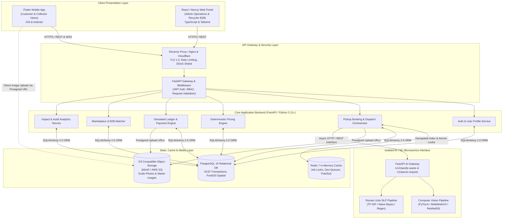
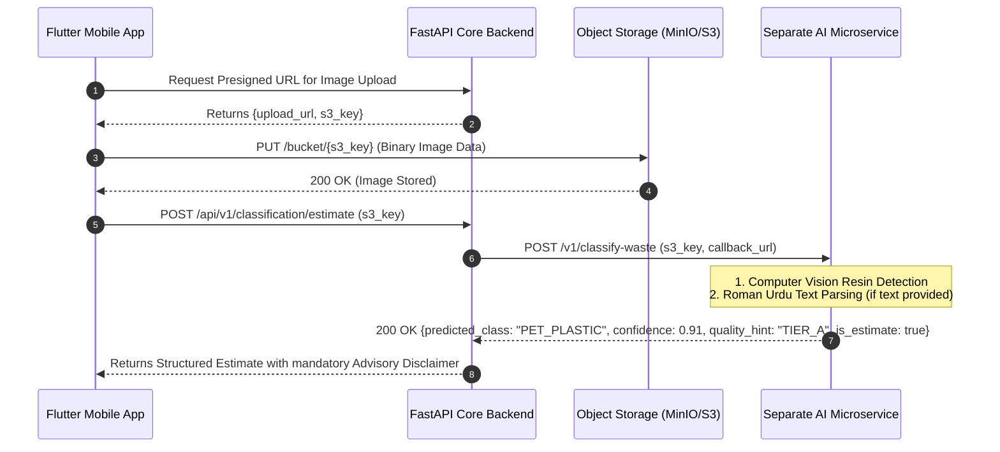

# SafaiPay Phase 1: Technical System Architecture
**Document Version:** 1.0.0  
**Phase:** Phase 1 MVP Pilot  
**Author:** Technical Lead & Solution Architect  

---

### 1. Architectural Overview & Design Tenets

SafaiPay is engineered as a decoupled, event-driven, modular service-oriented architecture designed to scale seamlessly from a controlled 10-collector pilot in Karachi to a high-throughput, multi-city circular economy exchange.

#### Core Architectural Tenets
1. **Separation of Concerns:** Clear demarcation between mobile client presentation, web administrative portals, asynchronous business orchestration, relational state storage, fast ephemeral caching, object storage, and specialized machine learning inference.
2. **Human-in-the-Loop AI Boundary:** The AI subsystem is isolated as a dedicated external microservice interface. The core backend treats AI predictions strictly as advisory metadata, enforcing physical verification gates in the transactional database before any financial or status transition occurs.
3. **Non-Custodial Simulated Financial Engine:** In strict compliance with State Bank of Pakistan (SBP) regulations, the financial layer operates purely as a double-entry simulated accounting ledger. The platform holds zero customer funds, storing transaction hashes and simulated settlement vouchers.
4. **Resilience & Offline Tolerance:** Field collectors operate on fluctuating 3G/4G connections. The mobile client implements an offline-first cache for scale photo captures and weight records, guaranteeing zero lost transactions.

---

### 2. High-Level System Architecture Diagram



---

### 3. Detailed Component Architecture

#### 3.1 Flutter Mobile Client (Customer & Collector)
- **Framework:** Flutter 3.x (Dart 3.x), compiling to native ARM64 Android APK and iOS.
- **State Management:** Riverpod / BLoC pattern for predictable state transitions and unidirectional data flow.
- **Role-Adaptive Interface:** A single unified binary supporting role switching based on user JWT claims:
  - *Customer Mode:* Focuses on intuitive camera-based booking, live status tracking, transparent pricing quotes, and digital OTP confirmation.
  - *Collector Mode:* Optimized for high outdoor sunlight readability, prominent touch targets, Roman Urdu audio-visual prompts, GPS tracking, and digital scale weight/photo logging.
- **Offline Storage & Sync Engine:** Local SQLite / Hive database with background sync (via `WorkManager`). When a collector enters a signal-deprived basement or yard, weighing entries and scale photo hashes are saved locally and synced automatically once connectivity is restored.
- **Camera & Image Compression:** On-device image compression (JPEG quality 75%, max dimension 1280px) prior to upload to optimize mobile data consumption for informal workers.

#### 3.2 React / Next.js Web Application (Admin & Recycler)
- **Framework:** Next.js 14+ (App Router) with TypeScript and Tailwind CSS.
- **Component System:** Radix UI / Shadcn UI primitives for enterprise accessibility and clean tabular presentation.
- **State Management & Caching:** TanStack React Query v5 for server-state caching, optimistic updates, and automatic cache invalidation.
- **Specialized Portal Roles:**
  - *Recycler B2B Portal:* Allows industrial recycling managers to post purchase tenders, inspect aggregated inventory specifications, monitor incoming delivery dispatches, and download simulated trade settlement vouchers.
  - *SafaiPay Admin Portal:* Operational dashboard for collector KYC approval (CNIC document review, scale serial binding), daily benchmark scrap price setting, dispute resolution queue, and real-time pilot KPI monitoring.

#### 3.3 Core Backend (FastAPI / Python 3.11+)
- **Framework:** FastAPI running on `uvicorn` / `gunicorn` workers, leveraging native Python asynchronous I/O (`asyncio`).
- **Data Validation & Schemas:** Pydantic v2 for high-performance schema serialization, strict type enforcement, and automated OpenAPI 3.1 specification generation.
- **Persistence Layer:** SQLAlchemy 2.0 (asyncpg driver) with Alembic for immutable database migration tracking.
- **Domain Modules:**
  - `auth`: Multi-tenant phone OTP authentication, JWT token issuance with role claims, and session invalidation.
  - `pickups`: State-machine lifecycle management (`PENDING` $\rightarrow$ `ASSIGNED` $\rightarrow$ `IN_TRANSIT` $\rightarrow$ `ARRIVED` $\rightarrow$ `WEIGHED` $\rightarrow$ `COMPLETED`).
  - `pricing`: Deterministic pricing calculation: $\text{Weight} \times \text{Rate} \times \text{Quality Factor}$.
  - `ledger`: Double-entry simulated financial ledger, ensuring that every debit corresponds to an exact credit, maintaining audit integrity.
  - `marketplace`: Tender lifecycle and batch aggregation algorithms connecting bulk collectors to recyclers.

#### 3.4 In-Memory Caching & Ephemeral Layer (Redis 7)
- **Atomic Dispatch Locking:** Implements `Redlock` / atomic `SETNX` keys to prevent double-acceptance race conditions when multiple collectors attempt to claim the same nearby pickup.
- **Geospatial Proximity Dispatch:** Uses Redis `GEOADD` and `GEORADIUS` / `GEOSEARCH` to identify available online collectors within a 3–5 km radius of a new pickup location.
- **Token Blacklisting & Rate Limiting:** Enforces sliding-window rate limits (e.g., 60 requests/min per IP) and instant revocation of JWT tokens upon user logout or administrative suspension.
- **WebSocket Pub/Sub:** Coordinates real-time status push events to mobile and web clients without polling overhead.

#### 3.5 Relational Database (PostgreSQL 16 + PostGIS)
- **Relational Integrity:** Strict foreign keys, unique constraints, and check constraints to guarantee ACID compliance for financial and weighing ledgers.
- **Spatial Extensions (PostGIS):** Used for precise customer address geocoding, pilot corridor boundary enforcement, and historical collection spatial clustering.
- **Audit Trails:** Database triggers log immutable change histories for critical tables (`material_price_history`, `simulated_transactions`, `lender_consent_logs`).

#### 3.6 Object Storage Layer (S3-Compatible / MinIO)
- **Media Assets:** Secure, distributed storage for customer waste photos, collector on-site scale weight photos, recycler receiving weighbridge tickets, and KYC documents.
- **Direct-to-S3 Presigned Uploads:** The mobile app requests a secure presigned upload URL from the FastAPI backend and uploads binary image streams directly to Object Storage, eliminating backend proxy bottlenecks.

---

### 4. Separate AI Service Interface Specification

To maintain clean system boundaries and prevent heavy machine learning dependencies from impacting backend throughput, the AI engine is architected as an autonomous microservice.



#### 4.1 AI Service API Contract

##### Endpoint 1: Computer Vision Waste Classification
- **Method & Path:** `POST /v1/classify-waste`
- **Request Payload:**
```json
{
  "image_url": "https://storage.safaipay.org/pickups/2026/10/img_9482.jpg",
  "requested_categories": ["PET_PLASTIC", "CARDBOARD"],
  "model_version": "v1.2.0-karachi-pilot"
}
```
- **Response Payload:**
```json
{
  "status": "SUCCESS",
  "inference_timestamp": "2026-10-19T14:32:00Z",
  "prediction": {
    "material_code": "PET_PLASTIC",
    "material_name": "PET Plastic Bottles",
    "confidence_score": 0.924,
    "suggested_quality_tier": "TIER_A",
    "is_estimate": true,
    "disclaimer": "AI classification is an advisory estimate only. Final verification is performed on-site by the verified collector."
  },
  "detected_objects": [
    {
      "label": "clear_plastic_bottle",
      "bounding_box": [120, 84, 450, 600],
      "score": 0.94
    }
  ]
}
```

##### Endpoint 2: Roman Urdu / English Text Request Parser
- **Method & Path:** `POST /v1/parse-request`
- **Request Payload:**
```json
{
  "raw_text": "Kal subah 10 baje 15 kilo gatta aur plastic ki botlein uthwa lein Clifton block 4 se",
  "sender_id": "usr_99182"
}
```
- **Response Payload:**
```json
{
  "status": "SUCCESS",
  "parsed_entities": {
    "intent": "PICKUP_REQUEST",
    "intent_confidence": 0.96,
    "materials": [
      {
        "material_code": "CARDBOARD",
        "raw_token": "gatta",
        "estimated_weight_kg": 15.0
      },
      {
        "material_code": "PET_PLASTIC",
        "raw_token": "plastic ki botlein",
        "estimated_weight_kg": null
      }
    ],
    "schedule": {
      "raw_temporal": "Kal subah 10 baje",
      "inferred_time": "2026-10-20T10:00:00+05:00"
    },
    "location_hint": "Clifton block 4"
  }
}
```

---

### 5. Data Flow & Communication Patterns

1. **Synchronous REST APIs (HTTP/2):** Used for all CRUD operations, user profile lookups, tender queries, and deterministic price calculations.
2. **Asynchronous Message Queues (Redis / Celery / Arq):**
   - Background push notifications to mobile devices.
   - Presigned image metadata synchronization.
   - Batch aggregation matching for recycler tenders.
3. **Real-time WebSockets:**
   - Collector job broadcast and live GPS status updates.
   - Immediate on-screen confirmation when customer provides the pickup completion OTP.

---

### 6. Security, Privacy & Regulatory Compliance Architecture

```
+----------------------------------------------------------------------------------------------------+
|                                    SECURITY & COMPLIANCE STACK                                     |
+-------------------+--------------------------------------------------------------------------------+
| Domain            | Implementation Mechanism                                                       |
+-------------------+--------------------------------------------------------------------------------+
| Transport & Data  | Strict TLS 1.3 encryption for all in-transit communications. AES-256           |
| at Rest           | volume encryption for PostgreSQL, Redis, and Object Storage buckets.           |
+-------------------+--------------------------------------------------------------------------------+
| Identity & Access | Role-Based Access Control (RBAC) enforced via FastAPI dependency injection.     |
| (RBAC)            | Scopes strictly segregated: Customer, Collector, Recycler, Admin.             |
+-------------------+--------------------------------------------------------------------------------+
| SBP Compliance    | Zero custodial banking footprint. All ledger tables explicitly marked as       |
| (Non-Custodial)   | SIMULATED_LEDGER. API endpoints do not accept or hold liquid cash or deposits. |
+-------------------+--------------------------------------------------------------------------------+
| Consent Ledger    | Explicit database audit table (`lender_consent_logs`) tracking worker opt-in   |
| (PECA Compliant)  | consent with SHA-256 signature, IP address, and timestamp before data sharing. |
+-------------------+--------------------------------------------------------------------------------+
```
