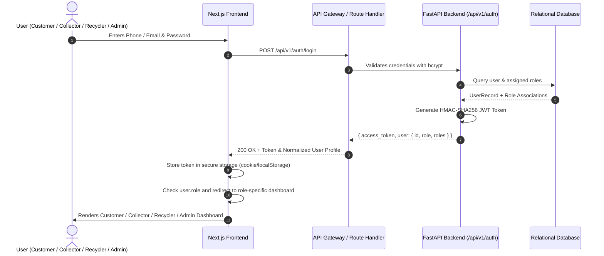

# SafaiPay Authentication & Authorization Flow

## 1. Overview
SafaiPay employs a robust, stateless JWT (JSON Web Token) authentication architecture combined with fine-grained Role-Based Access Control (RBAC). The system guarantees that every authenticated user is directed strictly to their authorized dashboard and never defaulted to Admin.

## 2. Authentication Sequence Diagram

## 3. Dynamic Role Extraction Algorithm
To ensure compatibility across microservices, mobile apps, and varying backend payload formats, the frontend implements `extractUserRole(data)`:
1. Direct inspection of `data.role` (string or `{ name: ... }`).
2. Inspection of `data.roles` array (strings or objects with `role_name`).
3. Inspection of sub-profile keys:
   - `data.admin_profile` -> `admin`
   - `data.collector_profile` -> `collector`
   - `data.recycler_profile` -> `recycler`
   - `data.customer_profile` -> `customer`
4. If role is unassigned or empty, user is safely routed to `/onboarding` to select their persona. **Users are never defaulted to Admin**.

## 4. Protected Route Guarding
Every role dashboard is guarded by `<ProtectedRoute allowedRole={['targetRole', 'admin']}>`.
- If unauthenticated -> redirected to `/login`.
- If authenticated but incorrect role -> redirected to `getDashboardPath(user.role)`.
- If role is `unknown` -> redirected to `/onboarding`.

## 5. Seed Test Credentials
| Role | Username / Identifier | Password | Default Redirect |
|---|---|---|---|
| **Admin** | `admin@safaipay.org` | `AdminPassword123!` | `/admin/dashboard` |
| **Customer** | `+923001110001` | `SafaiPassword123!` | `/customer/dashboard` |
| **Collector** | `+923002220001` | `SafaiPassword123!` | `/collector/dashboard` |
| **Recycler** | `+923003330001` | `SafaiPassword123!` | `/recycler/dashboard` |
