# SafaiPay Phase 1: Database Architecture & Entity-Relationship Diagram (ERD)
**Document Version:** 1.0.0  
**Phase:** Phase 1 MVP Pilot  
**Database Engine:** PostgreSQL 16 (with PostGIS Spatial Extension)  

---

### 1. Database Architecture & Design Principles

The SafaiPay relational schema is designed with strict integrity, financial auditability, and regulatory compliance at its core:
1. **Human-in-the-Loop Verification Separation:** In `pickup_items`, preliminary AI-estimated fields are segregated from collector-verified physical weights and quality factors to preserve an auditable discrepancy history.
2. **Double-Entry Simulated Financial Ledger:** The `simulated_transactions` table enforces accounting principles (every transaction has a source account, destination account, currency, and cryptographic reference), while explicitly remaining simulated without real-money custody.
3. **Consent & Privacy Compliance (PECA / SBP):** The `lender_consent_logs` table maintains an immutable, cryptographically verifiable record of explicit user consent before any collector financial profile can be exported.
4. **Geospatial Indexing:** Uses PostGIS geometry columns (`GEOMETRY(Point, 4326)`) indexed with GiST for sub-millisecond radius queries to dispatch nearby collectors.

---

### 2. Entity-Relationship Diagram (Mermaid)

```mermaid
erDiagram
    users ||--o{ user_roles : "has"
    roles ||--o{ user_roles : "assigned_to"
    users ||--o| collector_profiles : "collector_details"
    users ||--o| customer_profiles : "customer_details"
    users ||--o| recycler_profiles : "recycler_details"
    users ||--o| financial_identities : "builds"
    users ||--o{ lender_consent_logs : "grants"
    
    users ||--o{ pickups : "books_as_customer"
    users ||--o{ pickups : "fulfills_as_collector"
    
    pickups ||--|{ pickup_items : "contains"
    pickups ||--o{ pickup_photos : "evidence"
    pickups ||--o{ disputes : "contested_in"
    pickups ||--o{ simulated_transactions : "generates"
    
    materials ||--o{ pickup_items : "categorizes"
    materials ||--o{ material_price_history : "has_rate_history"
    materials ||--o{ marketplace_demands : "demanded_in"
    
    marketplace_demands ||--o{ marketplace_fulfillments : "fulfilled_by"
    marketplace_fulfillments ||--o{ simulated_transactions : "settles_via"
    
    users ||--o{ audit_logs : "triggers"

    users {
        uuid id PK
        varchar phone_number UK
        varchar full_name
        varchar email
        varchar status
        timestamp created_at
    }

    collector_profiles {
        uuid user_id PK, FK
        varchar cnic_number UK
        varchar vehicle_type
        varchar kyc_status
        varchar digital_scale_id
        geometry current_location
        boolean is_online
        decimal rating_average
    }

    customer_profiles {
        uuid user_id PK, FK
        varchar entity_type
        varchar organization_name
        text street_address
        geometry coordinates
        varchar contact_person
    }

    recycler_profiles {
        uuid user_id PK, FK
        varchar company_name
        varchar ntn_number UK
        text factory_address
        geometry coordinates
        varchar verification_status
    }

    materials {
        uuid id PK
        varchar code UK
        varchar name
        varchar unit
        decimal benchmark_rate_pkr
        boolean is_active
    }

    material_price_history {
        uuid id PK
        uuid material_id FK
        decimal benchmark_rate_pkr
        uuid changed_by FK
        timestamp effective_from
    }

    pickups {
        uuid id PK
        varchar tracking_number UK
        uuid customer_id FK
        uuid collector_id FK
        varchar status
        timestamp scheduled_time
        geometry pickup_location
        text address_text
        decimal total_price_pkr
        varchar completion_otp
        timestamp completed_at
    }

    pickup_items {
        uuid id PK
        uuid pickup_id FK
        uuid material_id FK
        decimal ai_estimated_weight_kg
        varchar ai_detected_category
        decimal verified_weight_kg
        varchar quality_tier
        decimal quality_factor
        decimal benchmark_rate_applied
        decimal total_item_price_pkr
    }

    pickup_photos {
        uuid id PK
        uuid pickup_id FK
        varchar photo_type
        varchar s3_url
        varchar sha256_hash
        jsonb ai_inference_metadata
        timestamp uploaded_at
    }

    simulated_transactions {
        uuid id PK
        varchar reference_id UK
        uuid pickup_id FK
        uuid fulfillment_id FK
        uuid sender_user_id FK
        uuid recipient_user_id FK
        decimal amount_pkr
        varchar transaction_type
        varchar ledger_status
        jsonb metadata
        timestamp created_at
    }

    financial_identities {
        uuid user_id PK, FK
        decimal total_verified_weight_kg
        integer completed_pickups_count
        decimal total_simulated_earnings_pkr
        decimal earnings_stability_score
        decimal dispute_ratio
        timestamp last_activity_at
    }

    lender_consent_logs {
        uuid id PK
        uuid collector_id FK
        varchar lender_institution_name
        varchar consent_scope
        boolean is_revoked
        inet ip_address
        varchar user_agent
        timestamp consented_at
        timestamp expires_at
    }

    marketplace_demands {
        uuid id PK
        varchar tender_number UK
        uuid recycler_id FK
        uuid material_id FK
        decimal target_quantity_kg
        decimal fulfilled_quantity_kg
        decimal offered_rate_pkr
        varchar status
        timestamp deadline
    }

    marketplace_fulfillments {
        uuid id PK
        uuid demand_id FK
        uuid batch_collector_id FK
        decimal dispatched_weight_kg
        decimal received_weight_kg
        varchar status
        timestamp delivered_at
    }

    disputes {
        uuid id PK
        uuid pickup_id FK
        uuid raised_by FK
        varchar reason_category
        text description
        varchar status
        text resolution_notes
        timestamp resolved_at
    }

    audit_logs {
        uuid id PK
        uuid actor_id FK
        varchar action_name
        varchar entity_name
        uuid entity_id
        jsonb previous_state
        jsonb new_state
        timestamp created_at
    }
```



---

### 3. Detailed Data Dictionary & Schema Specifications

#### 3.1 Table: `users`
Core identity table supporting multi-role participants.
- `id` (UUID, Primary Key, `gen_random_uuid()`): Unique identifier.
- `phone_number` (VARCHAR(20), Unique, Not Null): Primary identifier (E.164 format, e.g. `+923001234567`).
- `full_name` (VARCHAR(150), Not Null): Legal or operating name.
- `email` (VARCHAR(255), Nullable): Optional for informal workers; required for recyclers/offices.
- `status` (VARCHAR(30), Not Null, Default `'PENDING_ACTIVATION'`): Values: `PENDING_ACTIVATION`, `ACTIVE`, `SUSPENDED`, `DEACTIVATED`.
- `created_at` (TIMESTAMPTZ, Default `NOW()`): Account creation timestamp.

#### 3.2 Table: `collector_profiles`
Extended profile for informal waste workers (*kabaris*).
- `user_id` (UUID, PK, FK `users.id` ON DELETE CASCADE): Foreign key.
- `cnic_number` (VARCHAR(15), Unique, Not Null): Pakistani National Identity Card (e.g. `42101-1234567-1`).
- `vehicle_type` (VARCHAR(50), Not Null): Values: `HAND_CART`, `MOTOR_TRICYCLE`, `PICKUP_TRUCK`, `BICYCLE`.
- `kyc_status` (VARCHAR(30), Not Null, Default `'SUBMITTED'`): Values: `SUBMITTED`, `VERIFIED`, `REJECTED`.
- `digital_scale_id` (VARCHAR(50), Nullable): Serial number of calibrated hanging scale issued by SafaiPay.
- `current_location` (GEOMETRY(Point, 4326), Nullable): Real-time collector spatial coordinate.
- `is_online` (BOOLEAN, Default `FALSE`): Availability status to receive job broadcasts.
- `rating_average` (NUMERIC(3,2), Default `5.00`): Dynamic customer CSAT rating.

#### 3.3 Table: `customer_profiles`
Extended profile for residential societies, commercial offices, and households.
- `user_id` (UUID, PK, FK `users.id` ON DELETE CASCADE): Foreign key.
- `entity_type` (VARCHAR(50), Not Null): Values: `COMMERCIAL_OFFICE`, `HOUSING_SOCIETY`, `HOUSEHOLD`.
- `organization_name` (VARCHAR(200), Nullable): Name of office or society (e.g. *"Falcon Complex Society"*).
- `street_address` (TEXT, Not Null): Physical street and unit location in Karachi pilot corridor.
- `coordinates` (GEOMETRY(Point, 4326), Not Null): Geographic coordinates for geofence validation.
- `contact_person` (VARCHAR(150), Not Null): Designated focal representative.

#### 3.4 Table: `recycler_profiles`
Extended profile for B2B industrial recycling plants and packaging mills.
- `user_id` (UUID, PK, FK `users.id` ON DELETE CASCADE): Foreign key.
- `company_name` (VARCHAR(200), Not Null): Registered industrial corporate entity name.
- `ntn_number` (VARCHAR(30), Unique, Not Null): National Tax Number issued by FBR.
- `factory_address` (TEXT, Not Null): Drop-off processing gate address.
- `coordinates` (GEOMETRY(Point, 4326), Not Null): Plant weighbridge coordinates.
- `verification_status` (VARCHAR(30), Default `'VERIFIED'`): Admin verification state.

#### 3.5 Table: `materials`
Master catalog of supported recyclable categories.
- `id` (UUID, PK, `gen_random_uuid()`): Material identifier.
- `code` (VARCHAR(50), Unique, Not Null): E.g. `PET_PLASTIC`, `CARDBOARD_OCC`.
- `name` (VARCHAR(100), Not Null): Display title (e.g. *"PET Plastic Bottles"*, *"Corrugated Cardboard"*).
- `unit` (VARCHAR(20), Default `'kg'`): Measurement unit.
- `benchmark_rate_pkr` (NUMERIC(10,2), Not Null): Current platform benchmark rate per kg.
- `is_active` (BOOLEAN, Default `TRUE`): Active status for booking.

#### 3.6 Table: `material_price_history`
Immutable audit log of material benchmark rate adjustments.
- `id` (UUID, PK, `gen_random_uuid()`): Primary key.
- `material_id` (UUID, FK `materials.id`): Associated material.
- `benchmark_rate_pkr` (NUMERIC(10,2), Not Null): Updated benchmark price.
- `changed_by` (UUID, FK `users.id`): Administrator who authorized price modification.
- `effective_from` (TIMESTAMPTZ, Default `NOW()`): Timestamp of rate activation.

#### 3.7 Table: `pickups`
Primary operational transaction table tracking waste pickup lifecycles.
- `id` (UUID, PK, `gen_random_uuid()`): Unique pickup ID.
- `tracking_number` (VARCHAR(32), Unique, Not Null): Human-readable code (e.g. `SP-2026-10482`).
- `customer_id` (UUID, FK `users.id`, Not Null): Booking customer.
- `collector_id` (UUID, FK `users.id`, Nullable): Assigned collector.
- `status` (VARCHAR(30), Not Null, Default `'PENDING'`): Values: `PENDING`, `ASSIGNED`, `IN_TRANSIT`, `ARRIVED`, `WEIGHED`, `COMPLETED`, `CANCELLED`, `DISPUTED`.
- `scheduled_time` (TIMESTAMPTZ, Not Null): Selected booking slot.
- `pickup_location` (GEOMETRY(Point, 4326), Not Null): Location of pickup.
- `address_text` (TEXT, Not Null): Address notes / floor / landmark.
- `total_price_pkr` (NUMERIC(10,2), Default `0.00`): Sum of all verified item prices.
- `completion_otp` (VARCHAR(6), Nullable): 4-digit code generated for customer confirmation.
- `completed_at` (TIMESTAMPTZ, Nullable): Final transaction completion timestamp.

#### 3.8 Table: `pickup_items`
Individual material items within a pickup, explicitly isolating AI estimates from verified reality.
- `id` (UUID, PK, `gen_random_uuid()`): Item ID.
- `pickup_id` (UUID, FK `pickups.id` ON DELETE CASCADE, Not Null): Parent pickup.
- `material_id` (UUID, FK `materials.id`, Not Null): Material category.
- `ai_estimated_weight_kg` (NUMERIC(8,2), Nullable): Initial advisory weight estimate.
- `ai_detected_category` (VARCHAR(50), Nullable): AI classifier prediction tag.
- `verified_weight_kg` (NUMERIC(8,2), Nullable): **Physical scale weight entered by collector.**
- `quality_tier` (VARCHAR(20), Nullable): Values: `TIER_A`, `TIER_B`, `TIER_C`, `REJECTED`.
- `quality_factor` (NUMERIC(4,2), Nullable): Multiplier ($1.00$, $0.90$, $0.75$, $0.00$).
- `benchmark_rate_applied` (NUMERIC(10,2), Nullable): Benchmark price at time of verification.
- `total_item_price_pkr` (NUMERIC(10,2), Nullable): $\text{Verified Weight} \times \text{Rate} \times \text{Quality Factor}$.

#### 3.9 Table: `pickup_photos`
Photo evidence for AI inference and on-site scale verification.
- `id` (UUID, PK, `gen_random_uuid()`): Photo ID.
- `pickup_id` (UUID, FK `pickups.id` ON DELETE CASCADE, Not Null): Parent pickup.
- `photo_type` (VARCHAR(30), Not Null): Values: `CUSTOMER_PREVIEW`, `COLLECTOR_SCALE_DISPLAY`, `MATERIAL_SORTING_PROOF`.
- `s3_url` (VARCHAR(500), Not Null): Cloud object storage URI.
- `sha256_hash` (VARCHAR(64), Not Null): Image hash to prevent file tampering.
- `ai_inference_metadata` (JSONB, Nullable): Bounding boxes, confidence scores, and raw model output.
- `uploaded_at` (TIMESTAMPTZ, Default `NOW()`): Upload timestamp.

#### 3.10 Table: `simulated_transactions`
Non-custodial, double-entry simulated financial ledger.
- `id` (UUID, PK, `gen_random_uuid()`): Transaction ID.
- `reference_id` (VARCHAR(64), Unique, Not Null): Generated reference (e.g. `SIM-RAAST-902184019`).
- `pickup_id` (UUID, FK `pickups.id`, Nullable): Linked pickup (if applicable).
- `fulfillment_id` (UUID, FK `marketplace_fulfillments.id`, Nullable): Linked B2B batch.
- `sender_user_id` (UUID, FK `users.id`, Not Null): Simulated paying party.
- `recipient_user_id` (UUID, FK `users.id`, Not Null): Simulated receiving party.
- `amount_pkr` (NUMERIC(12,2), Not Null): Simulated currency amount in PKR.
- `transaction_type` (VARCHAR(50), Not Null): Values: `PICKUP_PAYOUT_SIMULATED`, `B2B_FULFILLMENT_SIMULATED`, `DISPUTE_ADJUSTMENT_SIMULATED`.
- `ledger_status` (VARCHAR(30), Default `'SETTLED_SIMULATED'`): Ledger status.
- `metadata` (JSONB, Nullable): Additional audit context.

#### 3.11 Table: `financial_identities`
Aggregated, verifiable digital earnings profile for informal workers.
- `user_id` (UUID, PK, FK `users.id` ON DELETE CASCADE): Collector ID.
- `total_verified_weight_kg` (NUMERIC(12,2), Default `0.00`): Cumulative verified kilograms collected.
- `completed_pickups_count` (INTEGER, Default `0`): Total successfully fulfilled pickups.
- `total_simulated_earnings_pkr` (NUMERIC(14,2), Default `0.00`): Cumulative simulated revenue earned.
- `earnings_stability_score` (NUMERIC(5,2), Default `100.00`): Algorithmic consistency index.
- `dispute_ratio` (NUMERIC(4,3), Default `0.000`): Ratio of disputed jobs to total completed jobs.
- `last_activity_at` (TIMESTAMPTZ, Nullable): Most recent transaction timestamp.

#### 3.12 Table: `lender_consent_logs`
Consent registry governing worker financial data export.
- `id` (UUID, PK, `gen_random_uuid()`): Consent record ID.
- `collector_id` (UUID, FK `users.id`, Not Null): Consenting collector.
- `lender_institution_name` (VARCHAR(150), Not Null): Name of partner institution (e.g. *"Microfinance Bank X"*).
- `consent_scope` (VARCHAR(100), Not Null): E.g. `INCOME_HISTORY_6_MONTHS`, `SCALE_FINANCING_APPLICATION`.
- `is_revoked` (BOOLEAN, Default `FALSE`): Immediate revocation flag.
- `ip_address` (INET, Not Null): IP of device at consent time.
- `user_agent` (VARCHAR(255), Not Null): Device user-agent string.
- `consented_at` (TIMESTAMPTZ, Default `NOW()`): Timestamp of explicit opt-in.
- `expires_at` (TIMESTAMPTZ, Not Null): Hard expiration timestamp (max 90 days).

---

### 4. Database Indexing & Performance Strategy

```sql
-- Spatial indexing for proximity-based collector dispatch
CREATE INDEX idx_collector_location ON collector_profiles USING GIST (current_location);
CREATE INDEX idx_pickup_location ON pickups USING GIST (pickup_location);

-- Fast lookup for open jobs and active status
CREATE INDEX idx_pickups_status_scheduled ON pickups (status, scheduled_time);
CREATE INDEX idx_collector_online ON collector_profiles (is_online, kyc_status);

-- Financial ledger immutable integrity indexing
CREATE INDEX idx_sim_trans_recipient ON simulated_transactions (recipient_user_id, created_at DESC);
CREATE INDEX idx_sim_trans_pickup ON simulated_transactions (pickup_id);

-- Unique constraint ensuring single active consent per lender/collector
CREATE UNIQUE INDEX idx_active_lender_consent ON lender_consent_logs (collector_id, lender_institution_name) 
WHERE is_revoked = FALSE;
```
