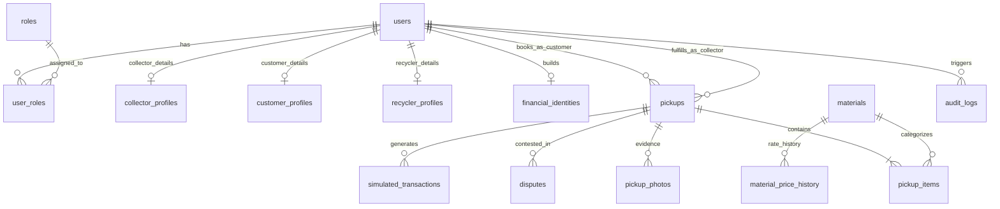

# SafaiPay Database Schema & Data Dictionary

## 1. Overview
The SafaiPay relational database models circular-economy interactions across customers, certified collectors, industrial recyclers, and system administrators. Supported on PostgreSQL 16 (production) and SQLite (local testing).

## 2. Entity-Relationship Diagram (ERD)

## 3. Core Tables Specification

### 3.1 `users`
| Column | Type | Constraints | Description |
|---|---|---|---|
| `id` | UUID / VARCHAR(36) | PRIMARY KEY | Unique user identifier |
| `phone_number` | VARCHAR(16) | UNIQUE, NOT NULL | Pakistani MSISDN (E.164: +923...) |
| `full_name` | VARCHAR(128) | NOT NULL | Verified name |
| `email` | VARCHAR(255) | NULLABLE | Notification email |
| `hashed_password`| VARCHAR(255) | NOT NULL | bcrypt hash |
| `is_active` | BOOLEAN | DEFAULT TRUE | Account state |
| `is_phone_verified`| BOOLEAN | DEFAULT FALSE | OTP verification flag |
| `created_at` | TIMESTAMP | DEFAULT NOW() | Account creation time |

### 3.2 `materials`
| Column | Type | Constraints | Description |
|---|---|---|---|
| `id` | VARCHAR(36) | PRIMARY KEY | Primary key |
| `code` | VARCHAR(32) | UNIQUE, NOT NULL | e.g. `PET_PLASTIC`, `CARDBOARD_OCC` |
| `name` | VARCHAR(64) | NOT NULL | Friendly display name |
| `unit` | VARCHAR(16) | DEFAULT 'kg' | Unit of measurement |
| `benchmark_rate_pkr` | NUMERIC(10,2) | NOT NULL | Benchmark PKR price per unit |
| `tier_a_factor` | NUMERIC(3,2) | DEFAULT 1.00 | Multiplier for Tier A |
| `tier_b_factor` | NUMERIC(3,2) | DEFAULT 0.85 | Multiplier for Tier B |
| `tier_c_factor` | NUMERIC(3,2) | DEFAULT 0.65 | Multiplier for Tier C |
| `is_active` | BOOLEAN | DEFAULT TRUE | Active pricing toggle |

### 3.3 `pickups`
| Column | Type | Constraints | Description |
|---|---|---|---|
| `id` | VARCHAR(36) | PRIMARY KEY | Unique pickup ID |
| `tracking_number`| VARCHAR(24) | UNIQUE, NOT NULL | Public tracking ref (SP-2026-XXXX) |
| `customer_id` | VARCHAR(36) | FK(users.id) | Booking customer |
| `assigned_collector_id` | VARCHAR(36) | FK(users.id), NULL | Assigned collector |
| `material_code` | VARCHAR(32) | FK(materials.code)| Primary material stream |
| `estimated_quantity_kg` | NUMERIC(8,2) | NOT NULL | Customer approximate weight |
| `street_address`| TEXT | NOT NULL | Doorstep location |
| `city` | VARCHAR(64) | DEFAULT 'Karachi' | City |
| `status` | VARCHAR(32) | NOT NULL | State machine status |
| `created_at` | TIMESTAMP | DEFAULT NOW() | Timestamp |

### 3.4 `simulated_transactions`
| Column | Type | Constraints | Description |
|---|---|---|---|
| `id` | VARCHAR(36) | PRIMARY KEY | Transaction ID |
| `pickup_id` | VARCHAR(36) | FK(pickups.id) | Related pickup |
| `amount_pkr` | NUMERIC(12,2) | NOT NULL | Net disbursement |
| `channel` | VARCHAR(32) | NOT NULL | EasyPaisa / JazzCash / Raast |
| `status` | VARCHAR(24) | NOT NULL | COMPLETED / FAILED / QUEUED |
| `reference_hash`| VARCHAR(64) | UNIQUE | SBP-compliant audit hash |
