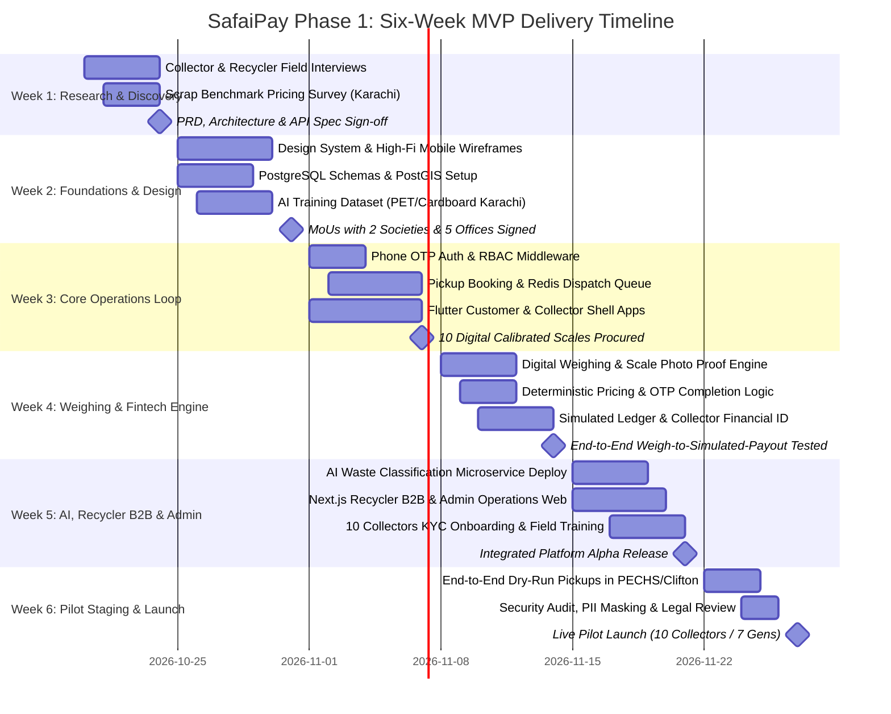

# SafaiPay Phase 1: Six-Week Implementation & Delivery Roadmap
**Document Version:** 1.0.0  
**Phase:** Phase 1 MVP Pilot  
**Timeline:** 6 Weeks (Sprint Iterations 1 to 6)  
**Target Launch Date:** End of Week 6  
**Pilot Cohort:** 10 Verified Waste Collectors, 2 Housing Societies, 5 Commercial Offices, 2 Recycling Facilities (Karachi)  

---

### 1. Delivery Strategy & Cross-Functional Team Ownership

The six-week execution plan is organized across four specialized team tracks to ensure continuous parallel progress with zero idle dependency locks:

```
+----------------------------------------------------------------------------------------------------+
|                                    TEAM ROLES & CORE ACCOUNTABILITIES                              |
+-------------------+----------------------------+---------------------------------------------------+
| Track Role        | Primary Focus Area         | Key Deliverables Across 6-Week Delivery Window    |
+-------------------+----------------------------+---------------------------------------------------+
| **Member 1**      | Product Architect &        | Design system, Flutter UI screens, responsive Web |
| Product / UX Lead | UI/UX Strategist           | dashboards, Urdu localization, usability testing. |
+-------------------+----------------------------+---------------------------------------------------+
| **Member 2**      | Backend Lead &             | FastAPI core services, PostgreSQL schemas, Redis   |
| Backend / DevOps  | Cloud Infrastructure       | queues, S3 storage, simulated ledger, API tests.  |
+-------------------+----------------------------+---------------------------------------------------+
| **Member 3**      | AI / ML Engineer &         | Waste image classifier microservice, Roman Urdu   |
| AI / Data Lead    | NLP Pipeline               | request parser, dataset labeling, inference APIs. |
+-------------------+----------------------------+---------------------------------------------------+
| **Member 4**      | Business Analyst &         | Partner MoUs (societies, offices, recyclers),     |
| Business / Ops    | Operations Coordinator     | collector onboarding (KYC), scale procurement.   |
+-------------------+----------------------------+---------------------------------------------------+
```

---

### 2. Week-by-Week Milestone Breakdown



---

### 3. Granular Weekly Work Packages

#### Week 1: Research, Specification & Operational Baseline
- **Member 1 (UX):** Conduct on-site shadowing with 5 informal *kabari* collectors and 2 commercial facility managers; draft initial paper wireframes and user interaction mental models.
- **Member 2 (Backend):** Finalize and freeze API schemas, establish GitHub repository with linting/CI hooks, set up Docker container environments for FastAPI, PostgreSQL 16, and Redis 7.
- **Member 3 (AI/ML):** Define computer vision dataset taxonomy for PET bottles (clear/blue) and Corrugated Cardboard (OCC); collect 200 initial local scrap photos.
- **Member 4 (Ops):** Conduct spot price survey across Karachi wholesale scrap markets (Shershah, Korangi); establish baseline benchmark rates (PET: PKR 80/kg, Cardboard: PKR 35/kg).
- **Week 1 Gating Milestone:** Full technical architecture, database ERD, and PRD approved.

#### Week 2: UX Design System, DB Migrations & Partner MoUs
- **Member 1 (UX):** Deliver Figma high-fidelity clickable prototype for Flutter mobile apps (Customer & Collector) and Next.js web portals; design high-contrast outdoor theme.
- **Member 2 (Backend):** Implement SQLAlchemy 2.0 models, Alembic database migrations, PostGIS spatial indexing, and Docker Compose staging environment.
- **Member 3 (AI/ML):** Train baseline ResNet50/MobileNetV3 transfer learning model on 600+ labeled waste images; build Roman Urdu text normalizer and regex token extractor.
- **Member 4 (Ops):** Secure written pilot participation agreements with 2 gated housing societies and 5 commercial office facilities in PECHS and Clifton.
- **Week 2 Gating Milestone:** Clickable Figma prototypes approved; database migrations executing cleanly; partner MoUs signed.

#### Week 3: Core Booking, Job Dispatch & Mobile Shell
- **Member 1 (UX):** Build Flutter authentication screens (Phone number, OTP verification) with English/Urdu bilingual toggle; build Customer booking form.
- **Member 2 (Backend):** Implement `/api/v1/auth/*` endpoints with SMS gateway integration; build pickup creation logic and Redis geospatial radius dispatch queue (`GEOSEARCH`).
- **Member 3 (AI/ML):** Wrap waste image classification and Roman Urdu text parser into an autonomous FastAPI microservice container exposing `/v1/classify-waste` and `/v1/parse-request`.
- **Member 4 (Ops):** Procure and calibrate 10 digital electronic hanging scales (50 kg capacity, 10g accuracy) with tare functionality for field issuance.
- **Week 3 Gating Milestone:** Customer can book a pickup; backend broadcasts job to Redis radius queue; mobile client authenticates via real OTP.

#### Week 4: Weighing Engine, Deterministic Pricing & Simulated Ledger
- **Member 1 (UX):** Build Collector job acceptance slider, camera-based scale display photo capture, and verified weight input screen with high-contrast digits.
- **Member 2 (Backend):** Implement atomic Redis lock (`SETNX`) for job claiming; build deterministic pricing calculator ($\text{Weight} \times \text{Rate} \times \text{Quality}$); implement double-entry simulated financial ledger (`simulated_transactions`).
- **Member 3 (AI/ML):** Implement scale photo verification pipeline (verifying that uploaded scale photo contains numeric digits matching entered weight).
- **Member 4 (Ops):** Onboard 10 informal waste collectors: collect CNICs, register mobile numbers, issue calibrated digital hanging scales, and run hands-on app tutorial.
- **Week 4 Gating Milestone:** Collector accepts job, enters physical scale weight, snaps photo, customer validates with 4-digit OTP, simulated ledger credits worker.

#### Week 5: Recycler B2B Dashboard, Admin Portal & AI Integration
- **Member 1 (UX):** Implement Next.js web pages for Recycler B2B portal (Tender posting, delivery confirmation) and Admin portal (KYC approval queue, pricing manager).
- **Member 2 (Backend):** Build marketplace endpoints (`/api/v1/marketplace/*`), dispute ticketing endpoints, and automated impact aggregation metrics with mandatory "Estimated" tags.
- **Member 3 (AI/ML):** Integrate Flutter camera with backend AI microservice; tune confidence score thresholds (flagging predictions < 0.70 for manual user override).
- **Member 4 (Ops):** Finalize offtake contracts with 2 industrial recycling facilities in Korangi Industrial Area; verify receiving dock weighbridge procedures.
- **Week 5 Gating Milestone:** Complete end-to-end integration: AI classification estimate $\rightarrow$ pickup $\rightarrow$ weighing $\rightarrow$ pricing $\rightarrow$ simulated payout $\rightarrow$ recycler tender fulfillment.

#### Week 6: Pilot Staging, Field Dry-Runs & Official Go-Live
- **Member 1 (UX):** Conduct on-site usability dry-runs with 3 collectors under direct sunlight; polish Roman Urdu audio alerts and button touch targets.
- **Member 2 (Backend):** Perform end-to-end stress testing, database query optimization, Redis connection pooling, and verify strict zero-custody compliance.
- **Member 3 (AI/ML):** Validate AI inference speed (< 1.5 seconds on 4G) and benchmark classifier accuracy on pilot samples.
- **Member 4 (Ops):** Coordinate official Day 1 pilot collection schedule: 5 commercial offices and 2 housing societies scheduled for recurring weekly pickups with 10 collectors.
- **Week 6 Gating Milestone:** **Live Pilot Launch!** Active real-world pickups operating across pilot corridors in Karachi with zero critical blockers.

---

### 4. Risk Checkpoints & Gating Criteria

```
+----------------------------------------------------------------------------------------------------+
|                                    GATE CHECKPOINTS & ACCEPTANCE CRITERIA                           |
+-------------------+--------------------+-----------------------------------------------------------+
| Checkpoint Gate   | Timing             | Strict Acceptance Gating Criteria                         |
+-------------------+--------------------+-----------------------------------------------------------+
| **Gate 1: Specs** | End of Week 1      | 100% agreement on API contracts, ERD, and PRD scope.      |
+-------------------+--------------------+-----------------------------------------------------------+
| **Gate 2: DB/UX** | End of Week 2      | Clean PostgreSQL migrations; interactive Figma prototype. |
+-------------------+--------------------+-----------------------------------------------------------+
| **Gate 3: Core**  | End of Week 3      | Working OTP login; Redis radius dispatch functional.      |
+-------------------+--------------------+-----------------------------------------------------------+
| **Gate 4: Weigh** | End of Week 4      | Formula verified: Weight * Rate * Q; simulated ledger OK. |
+-------------------+--------------------+-----------------------------------------------------------+
| **Gate 5: Alpha** | End of Week 5      | Recycler portal, Admin portal, and AI service connected.  |
+-------------------+--------------------+-----------------------------------------------------------+
| **Gate 6: Pilot** | End of Week 6      | 10 vetted collectors with scales, 7 facilities active.    |
+-------------------+--------------------+-----------------------------------------------------------+
```
