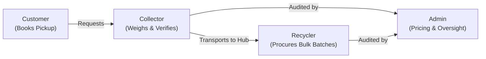

# SafaiPay End-to-End User Journeys

## 1. Overview
SafaiPay unifies 4 key personas in a circular-economy marketplace. Every workflow is designed for transparency, verifiable scale weights, and fraud-resistant transactions.

---

## 2. Journey 1: Customer Doorstep Pickup
1. **Initiation:** Customer opens `/customer/book-pickup`, selects material (e.g. PET Plastic, Cardboard), and enters estimated weight.
2. **AI Assistance (Optional):** Customer uploads a photo of the waste stream. Computer vision models return confidence score and purity grade.
3. **Dispatch:** Pickup is assigned a tracking number (e.g. `SP-2026-9041`) and broadcast to nearby collectors.
4. **On-Site Weighing:** Collector arrives with a certified digital scale, weighs the items, and customer inspects the reading.
5. **Mutual Settlement:** Customer shares the 4-digit confirmation code. Payout is instantly credited to customer's EasyPaisa / JazzCash wallet.

---

## 3. Journey 2: Collector Job Acceptance & Weighing
1. **Going On-Duty:** Collector opens `/collector/jobs` and toggles on-duty status.
2. **Accepting Job:** Collector views unassigned pickups within their assigned sector and clicks "Accept Job".
3. **Navigation & Verification:** On arrival, collector navigates to `/collector/active-job`, records calibrated digital weight, selects quality grade (Tier A/B/C), and uploads photo evidence.
4. **Instant Settlement:** Collector inputs customer's 4-digit OTP. The engine calculates customer payout + collector commission and credits both parties.
5. **Income Building:** Verified transaction logs build the collector's digital credit rating at `/collector/income-profile`.

---

## 4. Journey 3: Recycler Bulk Procurement & Traceability
1. **Catalog Exploration:** Recycler visits `/recycler/marketplace` to browse wholesale lots (PET flakes, OCC bales, HDPE pellets).
2. **Purchase Order:** Recycler submits a procurement request specifying target facility delivery.
3. **Freight & Gate-In:** At `/recycler/dispatch`, the freight carrier's gross, tare, and net weighbridge receipts are tracked.
4. **ESG Provenance:** Recycler inspects `/recycler/traceability` to obtain verifiable chain-of-custody documentation for circular brand audits.

---

## 5. Journey 4: Admin Oversight & Operations
1. **Fleet Monitoring:** Admin monitors `/admin/operations` to ensure SLA compliance and balanced collector coverage across districts.
2. **Dynamic Pricing:** Admin updates benchmark rates and quality factors at `/admin/pricing`.
3. **Payment Reconciliation:** Admin audits disbursement queues and gateway liquidity at `/admin/payments`.
4. **Fraud Mitigation:** Admin reviews computer vision duplicate alerts and abnormal weight spikes at `/admin/fraud-alerts`.
