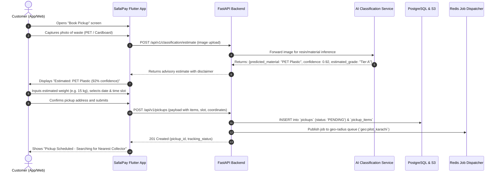
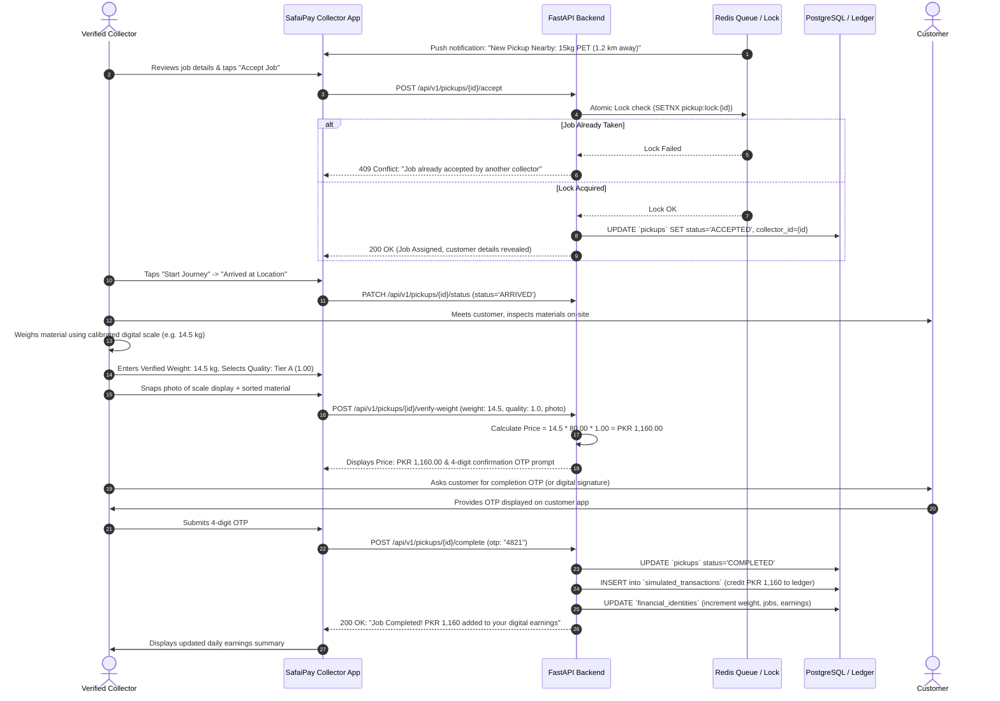
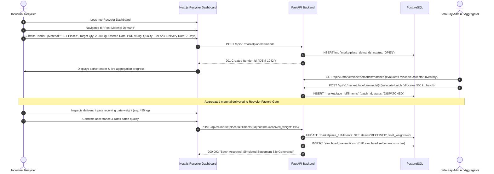
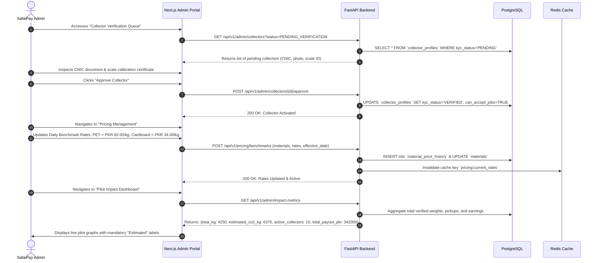

# SafaiPay Phase 1: End-to-End User Journeys
**Document Version:** 1.0.0  
**Phase:** Phase 1 MVP Pilot  
**Actors:** Customer (Generator), Collector (Waste Worker), Recycler (B2B Buyer), Admin (Operations Manager)  

---

### 1. Overview & Operational Principles

The SafaiPay user experience connects four distinct stakeholders in a closed-loop circular economy workflow. Every journey is engineered to adhere to SafaiPay's core business principles:
1. **AI as Advisory:** AI classification provides an immediate preliminary estimate to set customer expectations, but never dictates final transactions.
2. **Deterministic On-Site Verification:** Final transaction pricing is calculated strictly by the formula:  
   $$\text{Total Price} = \text{Verified Weight (kg)} \times \text{Material Benchmark Rate (PKR/kg)} \times \text{Quality Factor}$$
3. **Simulated Sandbox Payments:** The MVP uses an auditable, double-entry simulated financial ledger without holding real customer funds.
4. **Transparent Consent & Estimated Impact:** Financial identity creation is user-owned, and environmental figures are explicitly labelled "Estimated".

---

### 2. User Journey 1: Customer Booking a Recyclable Pickup

#### 2.1 Narrative & Goal
A corporate office administrator or residential housing society manager has accumulated segregated recyclables (PET plastic bottles or flattened cardboard boxes) and wants to request a prompt, verified, and transparent pickup.

#### 2.2 Pre-conditions
- Customer has registered on the SafaiPay Flutter app or Web portal using mobile phone OTP verification.
- Customer profile includes an approved pickup address within the pilot zone (Karachi PECHS/Clifton/Gulshan).

#### 2.3 Post-conditions
- Pickup request is logged in PostgreSQL with status `SCHEDULED`.
- Redis broadcast notifies nearby verified collectors within a 3–5 km radius.
- Customer receives an in-app confirmation with estimated weight and price.

#### 2.4 Step-by-Step Flow

#### 2.5 Alternative & Exception Paths
- **E1. Low AI Confidence (< 0.70):** The app displays a polite disclaimer: *"AI cannot clearly identify this item. Please manually select either PET Plastic or Cardboard from the list."* The user manually selects the category, and the system flags the job as `MANUAL_CATEGORIZATION`.
- **E2. Mixed Language Text Request (Roman Urdu Helper):** If the customer types a free-form message (e.g. *"Kal subah 10 baje 20 kilo gatta uthwa lein"*), the backend NLP endpoint `/api/v1/classification/parse-request` extracts `material: Cardboard`, `weight: 20kg`, `time: tomorrow morning` and pre-populates the booking form.
- **E3. Out of Service Pilot Corridor:** If coordinates fall outside the pilot bounds, the system alerts the user: *"SafaiPay Phase 1 is currently operating exclusively in pilot sectors of Karachi. We have registered your interest!"*

---

### 3. User Journey 2: Collector Accepting and Completing a Job

#### 3.1 Narrative & Goal
A verified informal waste collector (*kabari* worker) equipped with a digital hanging hook scale and smartphone receives a nearby job, travels to the location, physically weighs and grades the material, logs proof, and records a verified digital earning.

#### 3.2 Pre-conditions
- Collector is KYC-verified by the SafaiPay Admin (valid CNIC, phone number, calibrated scale issued).
- Collector sets status to `ONLINE` on the SafaiPay mobile app.

#### 3.3 Post-conditions
- Pickup status advances: `ACCEPTED` $\rightarrow$ `IN_TRANSIT` $\rightarrow$ `ARRIVED` $\rightarrow$ `WEIGHED` $\rightarrow$ `COMPLETED`.
- Physical scale weight, quality factor, and photo proof are saved.
- Verified price is calculated deterministically.
- Simulated payment is credited to collector's digital ledger and customer account.
- Collector's digital financial profile updates immediately.

#### 3.4 Step-by-Step Flow

#### 3.5 Alternative & Exception Paths
- **E1. Material Quality Contamination:** Collector notices PET bottles contain heavy dirt, sand, or liquids. Collector selects `Tier C (0.75)` or rejects the batch. The app updates the price quote instantly. If customer disputes, both tap "Report Issue", putting the job into `DISPUTED` status for admin review.
- **E2. Weight Variance Alert (> 50% vs Estimate):** If customer estimated 10 kg but verified weight is 35 kg, the backend flags the transaction with `AUDIT_REQUIRED` flag to ensure no typo occurred, but allows completion once confirmed by customer OTP.
- **E3. Offline Mode in Basement/Dead Zone:** If network drops during weight recording, the Flutter app caches the verified weight, timestamp, GPS coordinate, and scale image in local SQLite/Hive storage, syncing to the server immediately when reconnecting.

---

### 4. User Journey 3: Recycler Posting Demand and Purchasing Material

#### 4.1 Narrative & Goal
A B2B industrial recycling facility (e.g., a plastic washing and pelletizing plant or paper mill) needs a steady supply of sorted PET or Cardboard. The recycler posts a demand tender on the SafaiPay Web Dashboard, reviews available aggregated inventory, commits to purchase a batch, and records the delivery receipt.

#### 4.2 Pre-conditions
- Recycler company is vetted by SafaiPay Admin (NTN/tax registration verified, factory address documented).
- Recycler has access to the React/Next.js B2B web portal.

#### 4.3 Post-conditions
- Demand tender is published in the marketplace.
- Aggregated collector batches are matched and allocated to the tender.
- Delivery receipt is logged upon batch drop-off at the recycling facility.
- Simulated B2B settlement voucher is generated.

#### 4.4 Step-by-Step Flow

#### 4.5 Alternative & Exception Paths
- **E1. Factory Gate Weight Discrepancy (> 3%):** If the factory gate weighbridge registers 470 kg instead of the dispatched 500 kg (due to transit moisture loss or sorting fines), the recycler enters the actual scale weight and uploads the weighbridge slip. The system logs a `WEIGHT_ADJUSTMENT` delta of 30 kg and alerts Admin.
- **E2. Material Rejection for Severe Contamination:** If the cardboard batch is soaked with water or oil, the recycler clicks "Reject Batch", enters photo evidence, and the status changes to `REJECTED_AT_DOCK`. Admin arranges secondary sorting or return.

---

### 5. User Journey 4: Admin Managing the Platform

#### 5.1 Narrative & Goal
The SafaiPay Operations Administrator manages daily platform health: onboarding and vetting collectors, establishing daily benchmark scrap rates, resolving pickup disputes, and monitoring estimated pilot environmental and financial inclusion impact.

#### 5.2 Pre-conditions
- Admin user has `SUPERADMIN` or `OPS_MANAGER` role privileges.
- Admin accesses the Next.js Operations Management Portal via multi-factor authentication.

#### 5.3 Post-conditions
- Collectors are vetted and authorized to accept live jobs.
- Benchmark pricing is published daily to regulate automated pricing formulas.
- Contested transactions are mediated and resolved.
- Aggregated pilot ESG and financial metrics are exported.

#### 5.4 Step-by-Step Flow

#### 5.5 Alternative & Exception Paths
- **E1. Dispute Resolution Flow:** Customer disputes a weight deduction. Admin opens `/admin/disputes/{id}`, views the scale photo proof uploaded by the collector, compares with customer comments, and can issue a simulated ledger adjustment credit to resolve goodwill.
- **E2. Suspected Fraudulent Entry:** Anomaly detection flags a collector submitting 250 kg PET in a single tricycle pickup (exceeding typical physical volume). Admin temporarily pauses the collector's account and initiates an inspection call.

---

### 6. User Journey Summary & Business Rule Matrix

| Journey Stage | Primary Actor | Mandatory Business Rule Enforced | Fail-Safe Mechanism |
| :--- | :--- | :--- | :--- |
| **Pickup Booking** | Customer | AI classification must be displayed as an advisory estimate only. | Manual category selection fallback if image is unclear or confidence < 0.70. |
| **On-Site Weighing** | Collector | Deterministic formula: $\text{Weight} \times \text{Rate} \times \text{Quality Factor}$. | Scale photo proof and customer OTP confirmation required to close job. |
| **Financial Settlement** | Collector & Customer | Simulated ledger only; no pooling or custody of customer funds. | Ledger entries stored as immutable records with mock transaction references. |
| **Worker Identity** | Collector | Financial data is private; zero sharing with lenders without consent. | Explicit consent check required before any financial profile export. |
| **Marketplace Off-take** | Recycler & Admin | B2B batch traceability from collector to factory gate. | Factory weighbridge delta logging to capture moisture/sorting shrinkage. |
| **Impact Reporting** | All | Environmental metrics must display "Estimated" label. | UI templates hardcode "Estimated" watermark on all carbon and diversion figures. |
